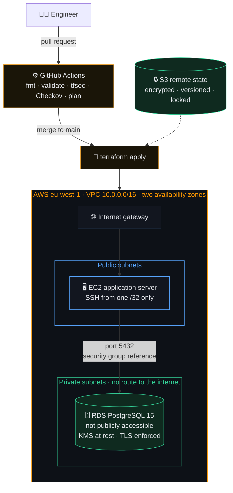
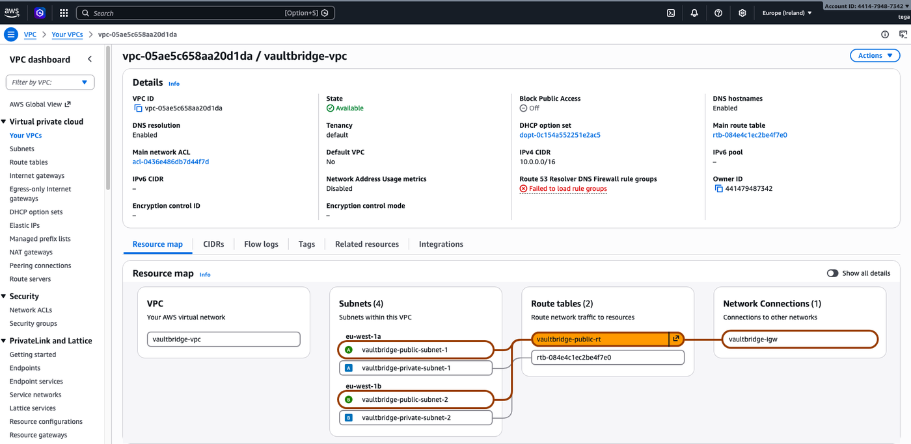
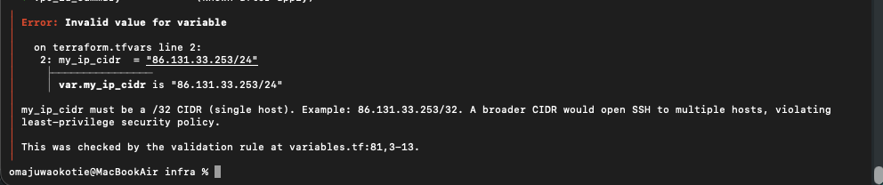
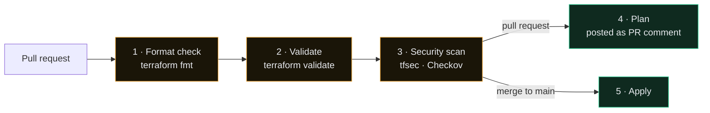
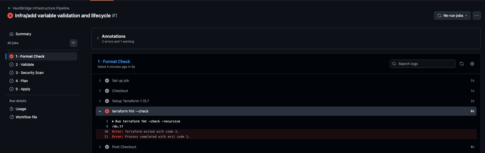
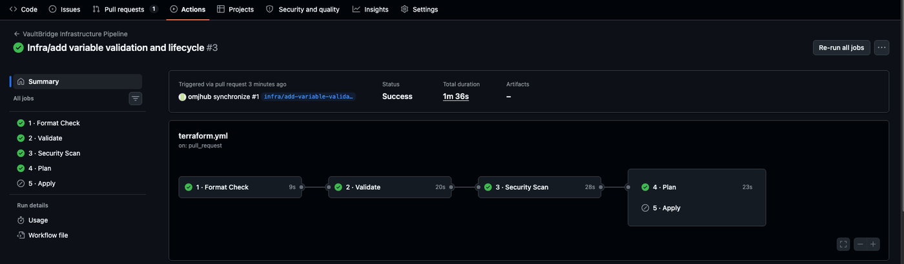
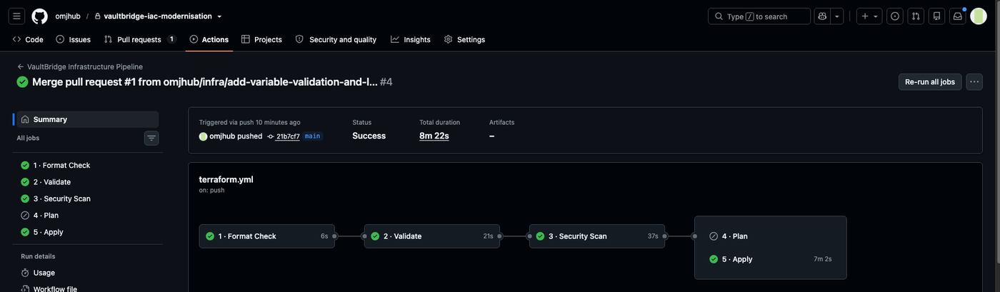
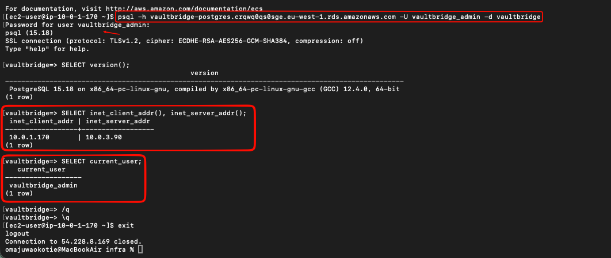
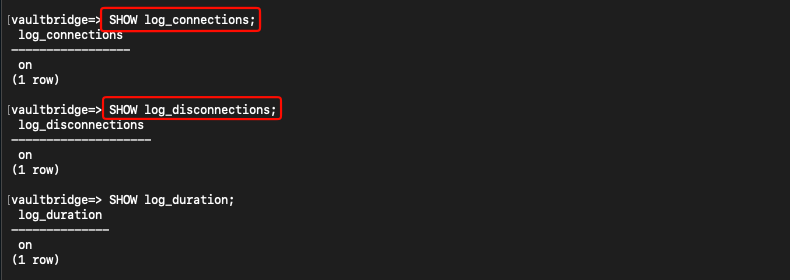

# VaultBridge: Infrastructure as Code Modernisation on AWS


A three-tier AWS architecture provisioned entirely in Terraform and deployed only through a reviewed CI/CD pipeline, never through a local `terraform apply`. Built to remove the root cause of a $214,000 security incident in the client brief: a database port opened to the whole internet through a manual console change.

**Design principle: make the unsafe approach harder than the safe one, structurally, not just procedurally.**

📄 **[Read the full technical report (PDF, 34 pages)](vaultbridge-technical-report.pdf)**

---

## Contents

- [The brief](#the-brief)
- [Highlights](#highlights)
- [Architecture](#architecture)
- [Security design decisions](#security-design-decisions)
- [The validation block that mirrors the incident](#the-validation-block-that-mirrors-the-incident)
- [Pipeline: plan on pull request, apply on merge](#pipeline-plan-on-pull-request-apply-on-merge)
- [Security scanning: findings triaged, not hidden](#security-scanning-findings-triaged-not-hidden)
- [Verification](#verification)
- [Results](#results)
- [Tech stack](#tech-stack)
- [Repository structure](#repository-structure)
- [Running it yourself](#running-it-yourself)
- [Production gaps and roadmap](#production-gaps-and-roadmap)
- [Lessons learned](#lessons-learned)
- [Author](#author)

---

## The brief

| | |
| --- | --- |
| **Client brief** | VaultBridge Financial Technologies: a fintech operating across Nigeria, Kenya, Ghana and Rwanda, with 2.4 million users, up to 340,000 transactions a day and a 99.95% uptime SLA, regulated by the Central Bank of Nigeria |
| **Engagement** | Infrastructure as Code modernisation, two-week programme |
| **Region** | AWS eu-west-1 (Ireland) |

**The incident.** Infrastructure was managed entirely through the AWS Console: no version control, no peer review, no automated validation. An engineer temporarily opened PostgreSQL port 5432 to the entire internet while debugging, got pulled into another call, and never reverted it. Automated scanners found the exposure in six minutes and launched a brute-force attack. The outage lasted **4 hours 12 minutes**, affected around **47,000 transactions** and cost **$214,000**.

**The real root cause** wasn't a skills gap. It was a system where the unsafe action (a broad CIDR range typed into a console with no review) was just as easy as the safe one. Every design decision below responds to that.

---

## Highlights

- **No manual changes.** Infrastructure can only change through a pull request, a reviewed plan and a merge to `main`.
- **Private database with no internet route at all.** Private subnets have no route to the internet gateway: an absent route, not a deny rule that a misconfigured security group could bypass.
- **Security group references, not IP ranges.** The database accepts traffic only from the application tier's security group, so access follows intent and survives instance replacement.
- **The incident is blocked before Terraform reaches AWS.** A validation block rejects any SSH CIDR broader than `/32` at plan time.
- **Ten validation rules** covering region, CIDRs, multi-AZ subnet counts, reserved database usernames and password length.
- **Every scanner finding triaged.** 11 failed Checkov checks, each with a written decision: fixed, accepted by design, or deferred with a production requirement.
- **Verified from two sources, not trusted from one.** All 19 success metrics checked against Terraform state, the AWS Console and the AWS CLI.

---

## Architecture



| Layer | Implementation |
| --- | --- |
| **Network** | VPC `10.0.0.0/16` across two availability zones; public subnets for EC2 and the internet gateway; private subnets for RDS with **no route to the internet gateway** |
| **Compute** | EC2 application server with an Elastic IP, AMI data source, key pair passed by variable, and lifecycle controls |
| **Database** | RDS PostgreSQL 15 with `publicly_accessible = false`, KMS encryption at rest, enforced TLS in transit, auto minor version upgrades, and connection, disconnection and duration audit logging for regulatory evidence |
| **Access** | RDS inbound only via a security group reference to the EC2 tier; SSH restricted to a single `/32` address |
| **State** | Two-stage bootstrap: a minimal local-state workspace creates the S3 backend, then all infrastructure uses encrypted, versioned remote state with native S3 locking |

**The deployed VPC in AWS:** two public and two private subnets across two availability zones, with only the public route table connected to the internet gateway.



---

## Security design decisions

| Decision | Why it matters |
| --- | --- |
| **Absent route, not a deny rule** | A deny rule can be overridden by a later misconfiguration. A private subnet with no internet route cannot reach the internet whatever the security groups say. |
| **Security group reference instead of a CIDR** | A CIDR hard-codes an IP that breaks when the instance is replaced. A security group reference encodes the actual intent, "the app tier talks to the database", and survives replacement. |
| **`publicly_accessible = false`** | Removes the database's public DNS endpoint entirely, so there is nothing to find even if a rule is wrong. |
| **SSH limited to `/32`** | The smallest possible range, enforced by validation rather than by convention. |
| **Plan and apply separated** | The plan a reviewer approves on the pull request is the plan that gets applied on merge. |
| **Remote state, encrypted and locked** | No local state files on laptops, and no two people applying at the same time. |

---

## The validation block that mirrors the incident

The incident happened because a broad CIDR range was typed where a narrow one belonged. This validation block catches exactly that mistake before any AWS API call is made:

```hcl
variable "my_ip_cidr" {
  validation {
    condition     = can(cidrhost(var.my_ip_cidr, 0)) && endswith(var.my_ip_cidr, "/32")
    error_message = "my_ip_cidr must be /32. A broader CIDR violates least-privilege policy."
  }
}
```

Tested against a `/24`: the plan fails immediately with that message, before Terraform ever reaches AWS.



**All validation rules in [`infra/variables.tf`](infra/variables.tf):**

| Variable | Rule |
| --- | --- |
| `aws_region` | Only `eu-west-1`, `eu-west-2` or `af-south-1` |
| `vpc_cidr` | Must be a valid CIDR |
| `public_subnet_cidrs`, `private_subnet_cidrs` | Exactly two valid CIDRs each, for multi-AZ |
| `availability_zones` | Exactly two |
| `my_ip_cidr` | Must be a valid `/32` |
| `db_username` | At least 4 characters, and not `admin`, `root`, `postgres`, `administrator` or `superuser` |
| `db_password` | At least 12 characters |

---

## Pipeline: plan on pull request, apply on merge



A five-job GitHub Actions pipeline ([`terraform.yml`](.github/workflows/terraform.yml)). **Plan** runs only on pull requests and posts the plan as a PR comment for review. **Apply** runs only on a push to `main`, after review and merge.

**The pipeline proved itself by failing.** The first push to the feature branch failed the format check because `rds.tf` had inconsistent indentation introduced with a lifecycle block. The merge was blocked automatically, with no reviewer needing to catch it.



`terraform fmt` fixed it and the pull request pipeline passed all stages through to plan:



After review and merge, the push to `main` ran the apply job:



---

## Security scanning: findings triaged, not hidden

tfsec and Checkov run on every change. Checkov reported **46 passed and 11 failed** checks. Every failure was reviewed individually and given an explicit, documented decision instead of being blanket-suppressed. The main ones:

| Finding | Decision | Rationale |
| --- | --- | --- |
| Port 80 open to `0.0.0.0/0` | Accepted by design | A public web application needs open HTTP |
| Multi-AZ not enabled | Deferred, high priority | Doubles RDS cost on the free tier; flagged as the top production gap |
| Deletion protection off | Deferred | Needed for demo teardown; must be `true` in production |
| Backup retention = 0 | Deferred | AWS free-tier constraint; 7 days minimum in production |
| Auto minor version upgrade | **Fixed** | `auto_minor_version_upgrade = true` added to `rds.tf` |

The full triage of every finding is in the [technical report](vaultbridge-technical-report.pdf).

---

## Verification

Results were checked against at least two independent sources (Terraform state, the AWS Console and the AWS CLI) instead of trusting Terraform's own output.

End-to-end connectivity was confirmed by connecting from the EC2 instance to PostgreSQL directly:

- `inet_client_addr()` and `inet_server_addr()` both returned private `10.0.x.x` addresses, proving the connection never touched the public internet.
- `pg_stat_ssl` confirmed TLS was active from the **server's** point of view, not just the client's claim.

| Private, encrypted connection from EC2 to RDS | Audit logging enabled |
| --- | --- |
|  |  |

---

## Results

| Metric | Before | After |
| --- | :---: | :---: |
| How infrastructure changes | Manual AWS Console | **Terraform, pull request, reviewed plan, merge** |
| Database exposure | Port 5432 open to the internet | **Private subnet, no internet route, not publicly accessible** |
| Database access rule | IP range | **Security group reference** |
| Broad SSH range | Possible | **Rejected at plan time** |
| Validation rules | 0 | **10** |
| Checkov findings | Unknown | **11 failed checks, each with a written decision** |
| Formatting errors reaching `main` | Possible | **Blocked by the pipeline** |
| Success metrics | | **19 of 19 met, verified from two sources** |

---

## Tech stack

| Area | Tools |
| --- | --- |
| Infrastructure as code | Terraform 1.15 |
| Cloud | AWS: VPC, EC2, RDS, S3, IAM, KMS |
| Database | PostgreSQL 15 |
| CI/CD | GitHub Actions |
| IaC security scanning | tfsec, Checkov |
| State | S3 remote backend with native locking |

---

## Repository structure

```
.
├── .github/workflows/terraform.yml   # fmt, validate, tfsec and Checkov, plan on PR, apply on merge
├── bootstrap/
│   └── main.tf                       # Creates the S3 state backend (local state)
├── infra/
│   ├── backend.tf                    # S3 remote state with locking
│   ├── providers.tf                  # Provider and version pinning
│   ├── variables.tf                  # Inputs and the ten validation rules
│   ├── vpc.tf                        # VPC, public and private subnets, routing
│   ├── security_groups.tf            # Least-privilege EC2 and RDS rules
│   ├── ec2.tf                        # Application server
│   ├── rds.tf                        # PostgreSQL, encryption, TLS, audit logging
│   └── output.tf
└── vaultbridge-technical-report.pdf  # Full technical report
```

---

## Running it yourself

**Requirements:** Terraform 1.15+, AWS credentials, and an SSH key pair.

```bash
# 1. Create the remote state backend (one time)
cd bootstrap
terraform init && terraform apply

# 2. Provision the infrastructure
cd ../infra
terraform init
terraform plan -var="my_ip_cidr=<your-ip>/32"
```

In normal use, changes go through a pull request: the pipeline posts the plan for review, and `apply` runs only after merge to `main`. Run `terraform destroy` when finished to avoid AWS charges.

---

## Production gaps and roadmap

These were identified and documented rather than hidden:

| Priority | Gap | Production requirement |
| --- | --- | --- |
| High | Single-AZ database | Enable Multi-AZ: a single-AZ database is incompatible with a 99.95% SLA |
| High | Backup retention set to 0 | At least 7 days of automated backups |
| Medium | Deletion protection off | Enable deletion protection |
| Medium | Static AWS credentials in CI | Move to GitHub OIDC with a short-lived IAM role |
| Medium | Direct SSH access | Replace with AWS Systems Manager Session Manager |
| Low | HTTP only | Add an Application Load Balancer with ACM certificates for HTTPS |

---

## Lessons learned

- **Structure beats procedure.** A missing route or a validation rule protects you on a bad day; a policy document does not.
- **A failing pipeline is the best demo.** The format check that blocked a merge proved the controls more than any green run.
- **Verify from the outside.** Checking the database from the server side caught what trusting Terraform's output alone would have missed.
- **Every finding deserves a decision.** Triaging 11 Checkov failures one by one produced a clear, defensible list of production gaps.

---

## Author

**Omajuwa Okotie**, DevSecOps and Cloud Security Engineer

Delivered end to end from an industry client brief through AMDARI.

[Portfolio](https://omajuwaokotie.com) · [LinkedIn](https://www.linkedin.com/in/omajuwa-okotie-850950190) · [GitHub](https://github.com/omjhub)
